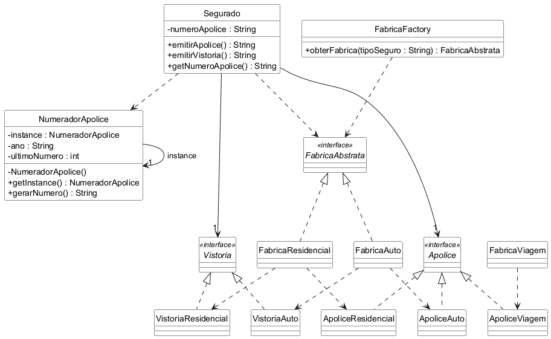

# Integração Singleton, Factory Method e Abstract Factory

Trabalho da disciplina Aspectos Avançados em Engenharia de Software.

Exemplo de integração de três padrões de criação em Java, com testes em JUnit 5.
O tema é o mesmo da seguradora dos trabalhos anteriores: quando um seguro é
contratado, o sistema precisa criar os documentos do tipo certo e dar um número
para a apólice que não pode se repetir.

- Factory Method: a `FabricaFactory` recebe o tipo de seguro pelo nome ("Auto"
  ou "Residencial") e devolve a fábrica certa, sem o resto do sistema precisar
  conhecer as classes das fábricas.
- Abstract Factory: a fábrica cria a apólice e a vistoria do mesmo tipo de
  seguro, então nunca sai uma apólice de automóvel com vistoria de imóvel.
- Singleton: o `NumeradorApolice` existe uma vez só, então todos os segurados,
  de qualquer tipo de seguro, pegam o número da mesma sequência.

O seguro viagem não tem vistoria, por isso a `FabricaViagem` não implementa a
`FabricaAbstrata`, e a factory recusa esse tipo como inválido.

## Diagrama de classes

